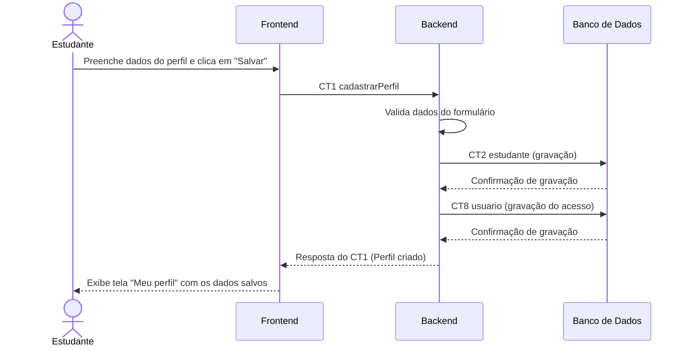

# Fluxo do E1: Cadastro de perfil do estudante

**Feito quando:** O estudante preenche nome, e-mail, curso, salva, e o perfil aparece na tela "Meu perfil" com os dados que ele digitou.

## Passos

1. O estudante preenche o formulário de perfil e clica em "Salvar".
2. O Frontend envia os dados do perfil para o Backend através da operação `cadastrarPerfil` (CT1).
3. O Backend valida os dados recebidos (campos obrigatórios e formatos).
4. O Backend grava as informações no Banco de Dados na tabela `estudante` (CT2).
5. O Backend grava o acesso do estudante (e-mail, senha criptografada e perfil) na tabela `usuario` do Banco de Dados (CT8).
6. O Banco de Dados confirma a gravação.
7. O Backend responde ao Frontend confirmando o cadastro do perfil.
8. O Frontend redireciona o estudante e exibe a tela "Meu perfil" com os dados atualizados.

## Diagrama

**Contratos usados:** CT1 cadastrarPerfil, CT2 estudante, CT8 usuario