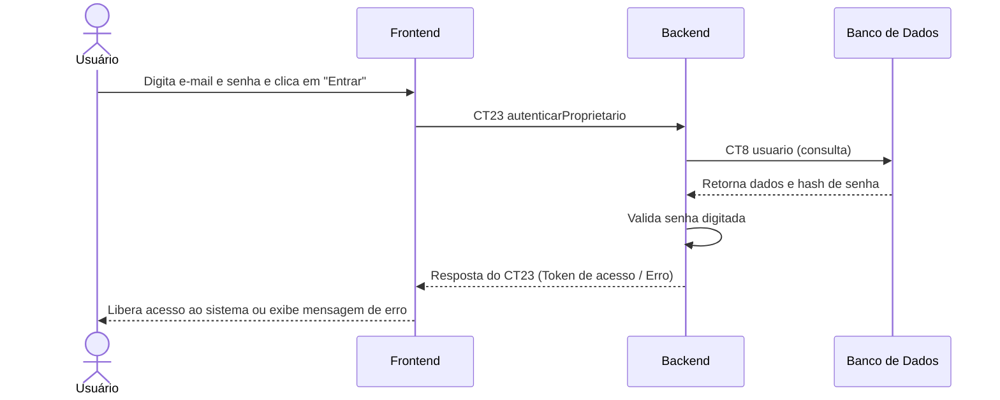

# Fluxo do E13: Login com e-mail pessoal do proprietário ou da moradia 

**Feito quando:** O usuário entra com e-mail e senha; senha errada mostra mensagem de erro; e-mail não cadastrado não conclui o login.

## Passos

1. O usuário digita o seu e-mail pessoal ou da moradia e a senha no formulário e clica em "Entrar".
2. O Frontend envia os dados de acesso para o Backend através da operação `autenticarProprietario` (CT23).
3. O Backend lê o registro correspondente no Banco de Dados na tabela `usuario` (CT8).
4. O Banco de Dados retorna o hash da senha e o perfil do usuário.
5. O Backend compara as credenciais e valida a autenticação.
6. O Backend responde ao Frontend retornando o token de acesso (ou o código de erro em caso de dados inválidos).
7. O Frontend autoriza a sessão ou exibe a mensagem de erro apropriada na tela.

## Diagrama

**Contratos usados:** CT23 autenticarUsuario, CT8 usuario

criar 
CT21  ok 
CT22  ok  
CT23