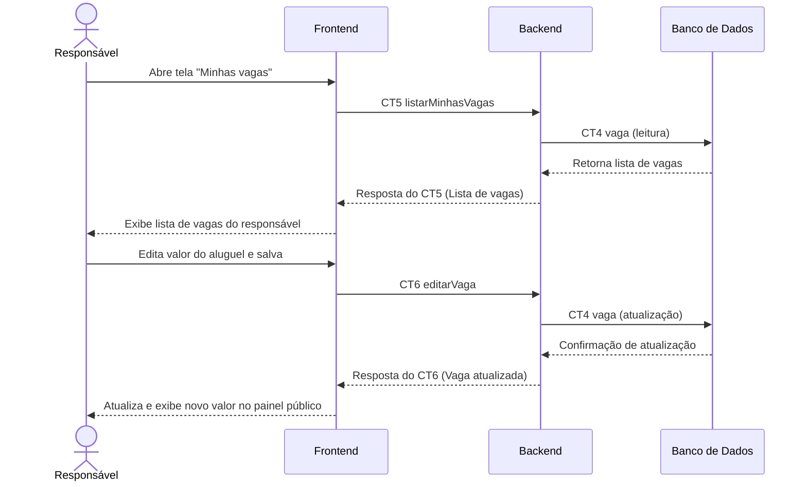

# Fluxo do E3: Painel “Minhas vagas” do responsável

**Feito quando:** O responsável abre o painel, vê todas as vagas que cadastrou, edita o valor de uma delas, e o novo valor aparece na página pública da vaga.

## Passos

1. O responsável abre a tela "Minhas vagas".
2. O Frontend consulta as vagas do responsável no Backend chamando `listarMinhasVagas` (CT5).
3. O Backend busca os registros na tabela `vaga` do Banco de Dados (CT4).
4. O Banco de Dados retorna os registros cadastrados.
5. O Backend devolve a lista de vagas para o Frontend.
6. O responsável seleciona uma vaga, edita o valor do aluguel e clica em "Salvar alterações".
7. O Frontend envia a atualização ao Backend com `editarVaga` (CT6).
8. O Backend atualiza o valor na tabela `vaga` do Banco de Dados (CT4).
9. O Banco de Dados confirma a atualização.
10. O Backend confirma a edição para o Frontend, que exibe o novo valor na página pública da vaga.

## Diagrama

**Contratos usados:** CT4 vaga, CT5 listarMinhasVagas, CT6 editarVaga