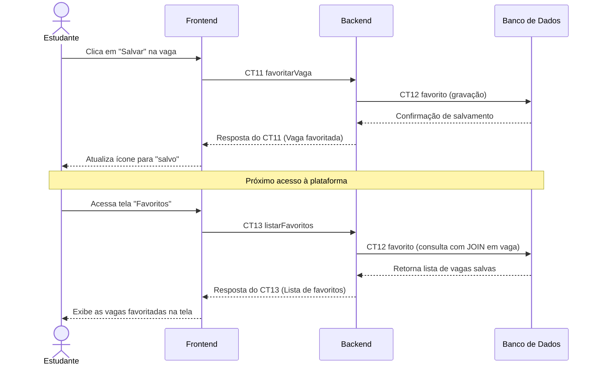

# Fluxo do E7: Favoritos

**Feito quando:** O estudante clica em "salvar" em uma vaga, e ela aparece na tela "Favoritos" na próxima vez que ele entrar.

## Passos

1. O estudante visualiza um card de vaga e clica no ícone "Salvar".
2. O Frontend invoca a operação `favoritarVaga` (CT11) no Backend informando os IDs.
3. O Backend insere o vínculo entre estudante e vaga na tabela `favorito` no Banco de Dados (CT12).
4. O Banco de Dados confirma a gravação.
5. O Backend devolve a confirmação de vaga favoritada ao Frontend.
6. Em um acesso posterior, o estudante clica na aba "Favoritos".
7. O Frontend solicita a lista de salvos ao Backend através de `listarFavoritos` (CT13).
8. O Backend consulta as vagas favoritadas no Banco de Dados (CT12).
9. O Banco de Dados retorna os detalhes das vagas.
10. O Frontend exibe todas as vagas salvas na tela de favoritos.

## Diagrama

**Contratos usados:** CT11 favoritarVaga, CT12 favorito, CT13 listarFavoritos