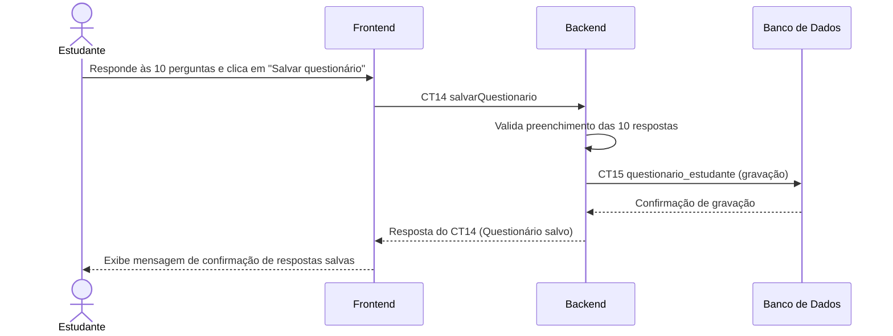

# Fluxo do E8: Questionário de convivência

**Feito quando:** O estudante responde 10 perguntas de hábitos (horário de dormir e acordar, limpeza, tolerância a ruído, visitas, pets) e as respostas ficam salvas no perfil dele.

## Passos

1. O estudante responde às 10 perguntas sobre seus hábitos de convivência e clica em "Salvar questionário".
2. O Frontend submete o conjunto de respostas ao Backend chamando `salvarQuestionario` (CT14).
3. O Backend valida se todas as 10 perguntas obrigatórias foram respondidas.
4. O Backend armazena as respostas na tabela `questionario_estudante` do Banco de Dados (CT15).
5. O Banco de Dados confirma a persistência das respostas.
6. O Backend confirma o salvamento com sucesso para o Frontend.
7. O Frontend confirma que os hábitos foram atualizados com sucesso no perfil do estudante.

## Diagrama

**Contratos usados:** CT14 salvarQuestionario, CT15 questionario_estudante