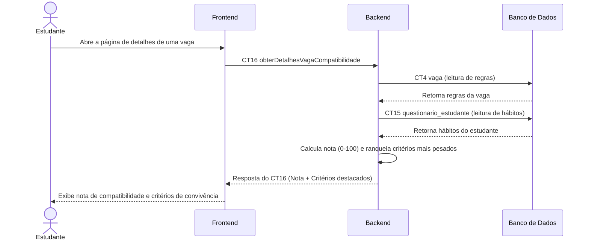

# Fluxo do E9: Pontuação de compatibilidade estudante × vaga

**Feito quando:** O estudante abre uma vaga e vê uma nota de 0 a 100 e a lista dos critérios que mais pesaram na nota; ao alterar uma resposta do questionário, a nota da mesma vaga muda.

## Passos

1. O estudante seleciona e abre uma vaga específica.
2. O Frontend solicita os detalhes e o cálculo de nota executando `obterDetalhesVagaCompatibilidade` (CT16).
3. O Backend busca as regras da vaga (CT4) e o questionário do estudante (CT15) no Banco de Dados.
4. O Banco de Dados retorna os dados cadastrados.
5. O Backend executa internamente o algoritmo de regras ponderadas de compatibilidade (calcula nota de 0 a 100 e ponderação dos critérios).
6. O Backend retorna a nota e os principais critérios positivos/negativos para o Frontend.
7. O Frontend exibe a pontuação e os critérios destacados.
8. Mais tarde, se o estudante atualiza um hábito no seu questionário (fluxo E8) e reabre a mesma vaga, o Backend recalcula a compatibilidade com base nos dados novos e retorna uma pontuação atualizada.

## Diagrama

**Contratos usados:** CT4 vaga, CT15 questionario_estudante, CT16 obterDetalhesVagaCompatibilidade