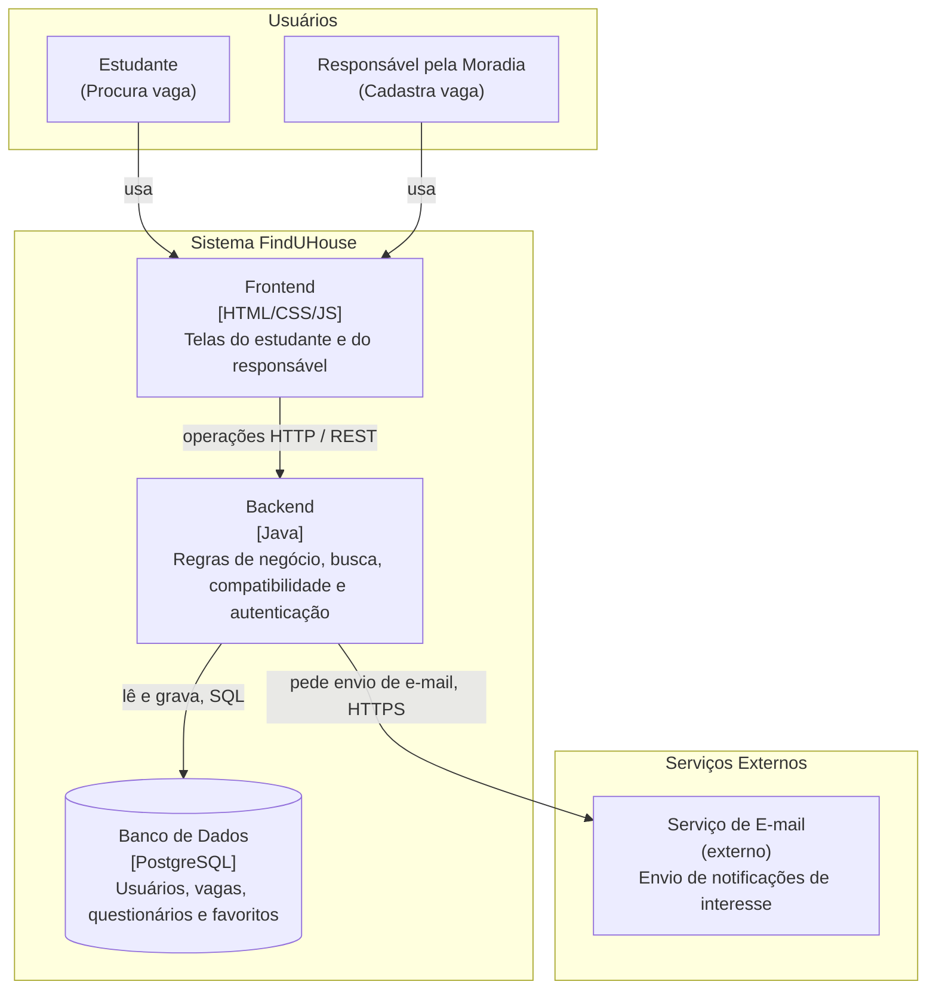

# Parte 1: Visão Geral — Sistema FindUHouse

## 1. Módulos do Sistema

| Módulo | O que faz | Tecnologia | Repositório | Responsável |
| :--- | :--- | :--- | :--- | :--- |
| **Frontend** | Interface web responsiva com as telas do estudante e do responsável pela moradia | HTML, CSS e JavaScript| pi4-2026-2-0101-grupo03-frontend| Ana Clara Chaves |
| **Backend** | Processa regras de negócio, cálculo de compatibilidade, autenticação e gerenciamento de vagas | Java (Spring Boot) | pi4-2026-2-0101-grupo03-backend | Maria Julia Pereira |
| **Banco de Dados** | Armazena dados de usuários, perfis, vagas, questionários, favoritos e denúncias | PostgreSQL | Junto do Backend | Brenda Maia |
| **Serviço de E-mail (externo)** | Envia notificações por e-mail quando há solicitação de interesse em uma vaga | Serviço de Terceiros (SMTP) | Não se aplica | Caio Cantarin |

---

## 2. Diagrama de Contêineres

---

## 3. Convenção de Nomes

**Idioma:** português, sem acentos, em todos os nomes de campos, rotas e operações.

**Campos nas mensagens entre módulos (API / JSON):** camelCase
(ex: `valorAluguel`, `regrasCasa`, `criadoEm`). Referências a outra entidade
usam o sufixo `Id` (ex: `vagaId`, `estudanteId`, `responsavelId`).

**Campos no banco de dados:** snake_case
(ex: `orcamento_min`, `distancia_maxima`, `criado_em`, `estudante_id`).
Tabelas ficam no singular (ex: `estudante`, `vaga`, `favorito`, `denuncia`).

**Mesmo campo entre camadas:** muda só a grafia
(ex: `criadoEm` na API ↔ `criado_em` no banco; `vagaId` ↔ `vaga_id`).

**Valores fixos de domínio (status e enumerações):** snake_case minúsculo
(ex: `em_analise`, `antes_das_22`).

**Operações:** verbo no infinitivo mais o objeto, em camelCase
(ex: `cadastrarVaga`, `buscarVagas`, `favoritarVaga`).

**Rotas HTTP:** prefixo `/api/` e substantivos no plural, em minúsculas
(ex: `/api/vagas`, `/api/favoritos`).

**Códigos de erro:** MAIÚSCULAS separadas por underscore
(ex: `VAGA_NAO_ENCONTRADA`, `ERRO_INTERNO`).